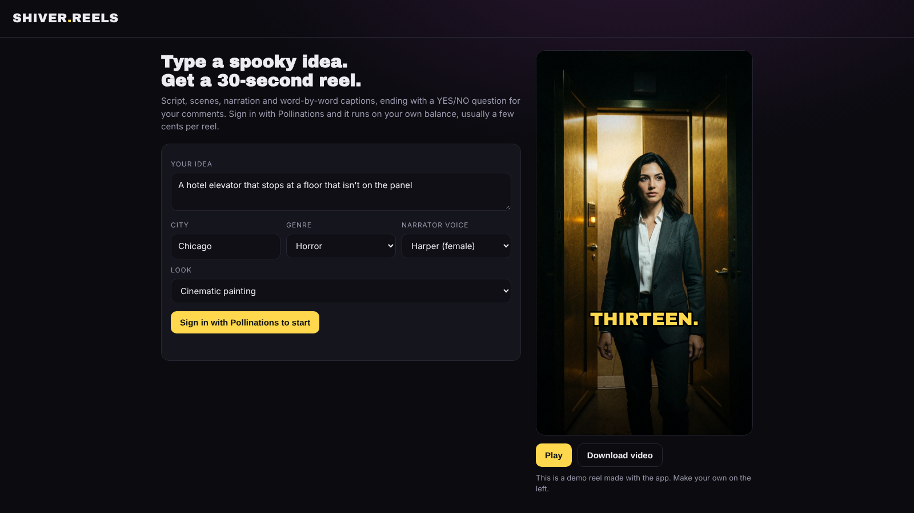

# Shiver Reels

[](https://pollinations.ai/?ref=badge)

Type a spooky idea, get a 30-second vertical story reel.

**Try it:** https://tojievfk.github.io/shiver-reels/



## What it does

1. **Script.** A Pollinations text model writes six short first-person lines, a consistent look for the narrator, and a YES/NO question for the comments. Every line is editable.
2. **Scenes and voice.** Each line gets a 9:16 image (`klein`) and its own narration clip (`microsoft/mai-voice-2.1`, seven voices to pick from).
3. **Reel.** The browser cuts it together on a canvas: Ken Burns motion, punch-in cuts, word-by-word captions synced to each clip, a title card, an ambient drone, and an end card with YES/NO buttons over a heartbeat.
4. **Download.** Records a 720x1280 MP4 (or WebM) in real time, ready for Reels, Shorts or TikTok.

A demo reel made with the app plays before you sign in.

## Pollinations sign-in

The app uses the `<polli-connect>` button, so visitors sign in with their own Pollinations account and spend from their own balance (capped at the budget they approve). Nobody pastes a key, and the key only lives in the browser tab. A reel usually costs a few cents.

The `pk_` app key in `index.html` is a publishable key: it only identifies the app on the consent screen and can't spend anything.

## Run it yourself

It's one static `index.html`, no build step. Serve the folder with any static server:

```bash
python3 -m http.server 8000
```

`tools/make_demo.py` regenerates the demo assets in `demo/` from `demo/story.json` (needs `POLLINATIONS_KEY` in your environment).

## Credits

- Text, image and voice generation: [pollinations.ai](https://pollinations.ai)
- Font: Archivo Black (SIL Open Font License, see `fonts/OFL.txt`)

MIT licensed.
